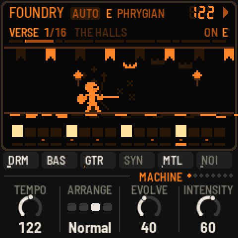
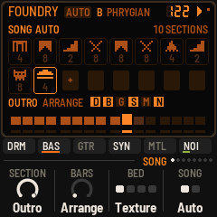
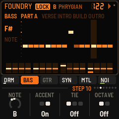

# IND-1 for the M-VAVE FM-1

[](https://github.com/devrvega/IND-1/actions/workflows/build.yml)
[](https://github.com/devrvega/IND-1/releases/latest)
[](LICENSE)

IND-1 turns the M-VAVE FM-1 into a self-playing industrial machine, after the late-80s and 90s records of
KMFDM, Nine Inch Nails and Ministry. It starts the moment it's switched on and arranges its own songs
(intros, verses, builds, choruses, breakdowns, drops) out of six layers: distorted drums through a crusher,
a Pro-1-style sequenced bass, two synthesized guitars, Xpander / Prophet VS-style FM stabs, metal
percussion, and a bed of drone and static. You steer it, and when you like what it plays, you lock the song
and write it yourself, step by step.

On the screen the song is a quest through a dark keep, on an LCD of the old handheld kind: near-black glass,
ember segments and their ghosts. The wanderer at the gate, in the halls, up the stair, in battle, at the
campfire, against the Warden, out into the dawn; the drums swing the sword, the bass walks, the guitars
flare the torches, the synth circles magic, the metal strikes sparks.



| | |
|---|---|
| **[Try it in the browser](https://devrvega.github.io/IND-1/emu/)** | The same code the FM-1 runs, with sound. No FM-1 needed. |
| **[Install it](https://devrvega.github.io/IND-1/install/)** | From Chrome or Edge, with the FM-1 on USB. Nothing to install on the computer. |
| **[Read the manual](docs/MANUAL.md)** | Getting started, then every control, page, editor and piece. |
| **[Download](https://github.com/devrvega/IND-1/releases/latest)** | The firmware file (`ind-X.Y.Z.fwsc`) of every release, and its source. |

## What's in it

- **A machine that writes songs:** six layers, one root, one mode (Phrygian, Locrian, Phrygian dominant,
  harmonic minor and more), in songs it arranges itself, a new one after each outro. Builds roll the snare
  and open the filters; drops land with a crash and a boom; sections end in fills, or a stop.
- **Played live:** a key moves the whole machine to its root on the next bar; REC throws in a breakdown,
  then the build, then the drop; EDIT moves on; OCT− fills, OCT+ mutates; any layer mutes.
- **Your songs:** lock a piece's song and it's yours: its three parts (verse, chorus, breakdown) written
  step by step, each with its chords; its sections laid out, each with its length, its layers and its bed of
  noise; the metal's two Euclidean rings. Every edit is heard from the next time round, and every bar of a
  locked song plays the same way each time.
- **Eight pieces**, each a recipe (Foundry, Rivethead, Neon Wound, Dead Air, Sledge, Cold Wire, Scrapyard,
  Klaxon), each remembering how you left it, and its song.
- **The space:** a ping-pong delay, a gated plate, and the kick pumping the rest. MIDI in and out, MIDI
  clock.

  

## In short

| | |
|---|---|
| Keys | The root: the machine moves to the key's note on the next bar |
| PLAY · REC · EDIT | Run / stop · breakdown, build, drop · the next section |
| OCT− · OCT+ | A fill · mutate (new riffs and lines) |
| HOME · SEQ · LFO · ENV · ARP · SEL · FX · GLO | The pages: Machine, Drums, Bass, Guitar, Synth, Metal, Space, Setup |
| A page's button again | Its editor: the song, the drums, the bass, the guitar, the synth, the metal's rings |
| In an editor | White keys the steps (or the sections), black keys the drum, the note or the layer; a step held: its own knobs; ENV + a step an accent, EDIT + a step cleared; SELECT the part |
| EDIT + a page button | Mute / unmute that layer |
| ALGORITHM · PRESETS | The mode · the piece |
| SAVE | Saves; held, the piece back to its recipe and its song to the machine |

Hold any button for a second and a card says what it does.

## Installing, and going back

- **From the browser:** the [web installer](https://devrvega.github.io/IND-1/install/) (Chrome or Edge, a USB
  data cable).
- **From the command line:** download `ind-X.Y.Z.fwsc` from the
  [latest release](https://github.com/devrvega/IND-1/releases/latest), then
  `pip3 install mido python-rtmidi` and `python3 tools/fm1_install.py ind-X.Y.Z.fwsc`.
- **Going back:** the installer's "Back to the stock firmware" puts M-VAVE's firmware back, as does M-VAVE's
  own updater, M-UPGRADE. Any other FM-1 firmware installs over IND-1 as it would over the stock one.
- **Your saved work:** IND-1 keeps its settings where several other FM-1 firmwares keep theirs (AMB-1, X0X,
  LCD-4 and others built on Felucca), and its songs where LCD-4 keeps its first eight patterns. Installing it
  starts it from its recipes, and its first save replaces what one of those had saved there. Settings from
  IND-1 0.1 carry over.

Installing other firmware is at your own risk, though it's hard to get stuck: an FM-1 that fails to start
twice comes up in a safe mode the installer can reach, and the manual's
[Troubleshooting](docs/MANUAL.md#12-troubleshooting) covers the rest.

## Status

IND-1 is young (0.x). It has been built, installed and run on an FM-1, and measured there: a verse takes
about a fifth of the FM-1's time, and the heaviest drop (every layer, the busiest piece) about half. How it
sounds on the FM-1's own speaker and through a PA, and how the editors feel under the fingers, is where
feedback helps most.

## Ideas and problems

- **Something you'd like:** a [feature request](https://github.com/devrvega/IND-1/issues/new?template=feature_request.yml).
- **Something wrong:** a [bug report](https://github.com/devrvega/IND-1/issues/new?template=bug_report.yml)
  (the version is at the bottom left of the Setup page, and on the start screen).

## Make it your own

Fork it, change it, release your own: [CONTRIBUTING.md](CONTRIBUTING.md) says where things are, how to give
your version its own name and identity, and how to send changes back. Every push is built and tested on
GitHub; a tag `vX.Y.Z` makes a release, and the site (emulator, installer, manual) follows it.

```
tests/run_tests.sh                               # the tests, the app in a simulator
./build.sh                                       # build/ind.fwsc (see BUILDING.md)
python3 tools/fm1_install.py build/ind.fwsc      # install it over USB
```

## Credits

IND-1 is built on [AMB-1](https://github.com/charlesvestal/fm1-amb) by Charles Vestal, a generative ambient
firmware for the FM-1: its engine's frame, screen, simulator and emulator. The reverb is Jon Dattorro's
plate ("Effect Design, Part 1", JAES 1997), by way of FoMni-1 and AMB-1; the Euclidean rhythms are Godfried
Toussaint's reading of Bjorklund's algorithm. The platform (hardware layer, USB, update loader, storage,
installer) is [Felucca](https://github.com/hugelton/Felucca)'s by Leo Kuroshita (Hügelton Instruments), by
way of [X0X](https://github.com/charlesvestal/fm1-x0x), FoMni and AMB-1. The idea of running FM-1 firmware
in the browser comes from [Groove OS](https://www.groove-os.com/). GPL-3.0-only; see
[LICENSING.md](LICENSING.md).

M-VAVE and FM-1 are trademarks of their owners. IND-1 is not affiliated with M-VAVE, KMFDM, Nine Inch
Nails, Ministry, Charles Vestal or Hügelton Instruments. Its scenes and characters are its own.
