# IND-1

IND-1 turns the M-VAVE FM-1 into a self-playing industrial machine, after the late-80s and 90s records of
KMFDM, Nine Inch Nails and Ministry. It starts the moment it's switched on and arranges its own songs:
intros, verses, builds, choruses, breakdowns and drops, out of distorted drums, a sequenced bass, two
guitars, FM stabs, metal and noise. You steer it: press a key and the whole machine moves to that root on
the next bar; throw in fills, breakdowns and drops; mute layers; mutate the riffs.

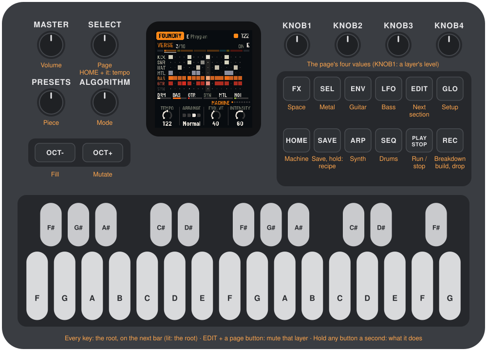

---

## Contents

1. Install
2. Getting started
3. Controls
4. The screen
5. The machine
6. The songs
7. The pieces
8. The pages
9. MIDI
10. Saving
11. Troubleshooting
12. Parameters
13. Credits

---

## 1. Install

**Try it first:** the browser emulator (`web/emu/`, built with `web/emu/build.sh`) runs the same code
with sound, played with the mouse, a touch screen or the keyboard.

**Install from the browser:** open the web installer (the site `tools/make_pages.py` makes) in Chrome or
Edge, connect the FM-1 with a USB data cable and press Install. Don't unplug it while it's writing; when
it finishes, the FM-1 restarts into IND-1.

**Install from the command line:** install Python 3 with `pip3 install mido python-rtmidi`, and from the
IND-1 source run:

```
python3 tools/fm1_install.py build/ind.fwsc
```

**Go back:** "Back to the stock firmware", at the bottom of the installer page, puts M-VAVE's firmware
back (download the FM-1 V15 file from the link there, choose it, press the button). M-VAVE's own
updater, M-UPGRADE, works too.

> Installing other firmware is at your own risk. If the FM-1 ever won't start, see
> [Recovering an FM-1 that won't start](#recovering-an-fm-1-that-won-t-start).

**Coming from AMB-1:** IND-1 keeps its settings where AMB-1 kept its pieces, under another name. Neither
reads the other's: installing IND-1 over AMB-1 starts IND-1 from its recipes, and going back to AMB-1
starts AMB-1 from its recipes.

---

## 2. Getting started

IND-1 starts as soon as it's on. A few minutes with it:

1. **Listen.** The first piece, Foundry, starts with an intro: hats and metal over a drone, the bass
   filter opening. After eight bars the verse kicks in: four on the floor, a galloping bass. Turn MASTER
   for the volume.
2. **Move the root.** Press a key. Its note blinks on the screen and on the keys; on the next bar the
   whole machine (bass, guitars, synth, drone) moves there.
3. **Throw in a fill.** Press OCT−: the rest of the bar is a drum fill.
4. **Break it down.** Press REC: at the next bar, a breakdown (tribal toms, a long dark chord, the
   drone up). Press REC again: a build (a snare roll, the filters and a riser climbing). Again, or wait:
   the drop.
5. **Move on.** Press EDIT: the next section of the song, after a fill.
6. **Mute a layer.** Hold EDIT and press ENV: the guitars drop out. Again: they're back.
7. **New riffs.** Press OCT+: from the next bar, new bass lines, riffs and stabs.
8. **Try another piece.** Turn PRESETS. Each of the eight pieces has its own groove, tempo, key, mode and
   sound.
9. **Stop.** Press PLAY: the machine stops, the tails ring out. PLAY again and it picks up where it was.

What you change is kept with the piece. IND-1 saves it by itself while stopped, or press SAVE.

Not sure what a button does? Hold it for a second: a card says. Let go and nothing happens.

---

## 3. Controls

The drawing at the top shows them all; here they are in more detail.

| Control | What it does |
|---|---|
| Keys | The root. A key's note becomes the root on the next bar (at once while stopped); every octave of a note is the same key. The keys of the root are lit; a new one blinks until the bar. |
| PLAY | Run / stop. IND-1 runs by itself when it's switched on. Stopped, the tails ring out; PLAY again picks up in the same section. Lit green while running. |
| REC | A breakdown, on the bar. In a breakdown: the build. In the build: the drop. After the drop, the song carries on where it left off. Lit through the breakdown and the build. |
| EDIT | The next section, on the bar (the rest of this bar fills). Held, with a layer's page button: mutes or unmutes that layer. |
| OCT− | A fill: the rest of this bar (at least its second half). |
| OCT+ | Mutate: new bass lines, riffs, stabs and metal from the next bar. |
| HOME · SEQ · LFO · ENV · ARP · SEL · FX · GLO | The pages: Machine, Drums, Bass, Guitar, Synth, Metal, Space, Setup. The lit button shows the page. |
| SELECT | The previous or next page. Hold HOME and turn it for the tempo, from any page. |
| ALGORITHM | The mode: Phrygian, Aeolian, Locrian, Phrygian dominant, harmonic minor, Dorian, blues, octatonic. |
| PRESETS | The piece (see [The pieces](#s7)). |
| KNOB 1–4 | The four values on the screen. A few clicks are always single steps; a quick turn speeds up, so half a turn sweeps the range. |
| MASTER | Volume. |
| SAVE | Saves all eight pieces. Held for 1.5 s: puts the piece back to its recipe. |
| OCT− + OCT+ | Held together for five seconds: update mode (for the installer). |

**Help:** hold any button but PLAY for a second and a card says what it does. A key, a knob or
another button puts the card away; letting go after it does nothing else.

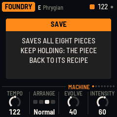

---

## 4. The screen

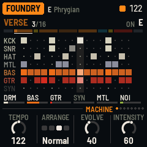
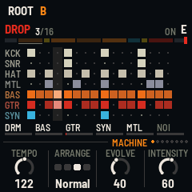

- **Top line:** the piece on an orange plate, the root sounding and the mode. While a new root waits for
  the bar, it blinks after an arrow. On the right, a beat light (a play triangle while stopped), the
  tempo (EXT when it follows MIDI clock) and a dot when there are unsaved changes. Messages ("ROOT A",
  "FILL") show here for a moment.
- **The section:** its name in its colour, the bar of it ("3/16", or LOOP), and on the right the chord's
  root, or what waits for the bar ("> BREAKDOWN", "> NEXT", "> MUTATE"), blinking.
- **The song:** under it, a strip of blocks, one per section, as long as it lasts. The one playing is lit
  and fills as it goes. A section reached by a button plays outside the plan: its colour shows at the
  strip's right end, and the song picks up after it.
- **The grid:** this bar, every row, sixteen steps in four beats: kick, snare (and toms), hats, metal,
  bass, guitar, synth. Brighter is harder; the playhead's column is lit. A layer that sits this section
  out has its name dimmed; a muted one turns red.
- **The layers:** at the bottom, the six layers (drums, bass, guitar, synth, metal, noise), each with a
  meter: white playing, grey resting this section, red muted.
- **The knobs:** the page's name (MUTED if it is), eight dots, one a page, then its four values, one for
  each knob: a dial (or, for a switch, its positions) and the value. The one you're turning lights up.

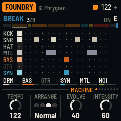
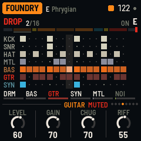

---

## 5. The machine

IND-1 plays six layers from one root and one mode.

- **Drums:** a 909-ish kick with its own drive, a snare (or, for EBM and Stomp, a clap), closed and open
  hats and a crash, toms for the fills and the breakdowns. Six grooves: EBM's four on the floor, a rock
  beat, a sampled break, half time, thrash (machine-gun kicks), a stomp. The drums run through a crusher,
  fewer bits and a lower sample rate, the crunch of an EMAX or an SP-12 pitched down. The snare's reverb is
  gated.
- **Bass:** a mono synth after the Pro-1 and the Minimoog: a saw and a square a few cents apart, a sine
  an octave down, through a resonant low-pass with its own envelope, then driven. It plays sixteenths,
  gallops, octaves (EBM's bounce), the b2 and the fifth, with accents and the odd slide.
- **Guitar:** two synthesized guitars, left and right, as a double-tracked rhythm part: power chords
  through a high-gain amp and a cabinet. Palm-muted chugs in the verses, open chords ringing over chugs in
  the choruses. They're synthesized, not sampled: think of them as an industrial guitar machine.
- **Synth:** stabs and short lines in the spirit of the Oberheim Xpander and the Prophet VS on *Pretty
  Hate Machine*: a saw crossfading into gritty FM (Tone), each note sweeping from a bright attack to its
  body. Stabs are chords on the scale; in a chorus, with Busy up, a line.
- **Metal:** inharmonic FM clangs (an anvil, scrap) and struck-sheet noise on two Euclidean patterns:
  one of 16 steps, one of 12, 9, 7 or 5 that slides across the bars (polyrhythm).
- **Noise:** a bed under it all: a drone (the root, beating against itself, and the tritone) or static
  (wandering filtered noise and crackle). Up in the intro and the breakdown, down under a chorus. Into a
  drop, a riser.

Then the space: a ping-pong delay (a dotted eighth, each repeat darker), Dattorro's plate behind a gate
the snare opens, and Pump: each kick ducks everything else for a moment.

---

## 6. The songs

IND-1 plays songs, one after another:

> intro · verse · (build) · chorus · verse · (build) · chorus · breakdown · build · drop · (chorus) · outro

The bracketed sections come in some songs and not others. After the outro a new song starts, from new
material (with Evolve at 0, the same song again).

- **Each section picks its layers.** The intro and the breakdown lean on the noise, the metal and the
  synth; verses on the drums and the bass (the guitars mostly wait for the chorus); choruses and drops
  bring everything in. **Intensity** leans every section fuller or sparser; at 100, every layer plays
  every chorus and drop. A layer you turn up from 0 joins the section at once.
- **The intro** starts with hats and metal over the drone, the filters closed; the kick joins halfway as
  they open. **The build** rolls the snare (quarters, eighths, sixteenths, then 32nds), pulses the bass,
  opens the filters and raises a riser. **The drop** (and a chorus after a build) lands with a crash and
  a deep boom. **The breakdown** is tribal toms over a lone kick, a long dark chord and the drone.
- **Fills:** the last bar of a section fills (snare runs, tom runs, kick and snare together, or a stop:
  one hit, then silence until the next section). Now and then a phrase ends with a short fill.
- **Chords:** verses mostly hold the root; choruses move (to the bVI and bVII, the b2, the iv), a quarter
  of the section a chord.
- **Evolve:** every four bars, with Evolve up, something changes: a bass note moves, a chug becomes an
  accent, the stabs turn, the metal shifts; ghost kicks and snares come and go.

**Arrange** sets the sections' lengths:

| Section | Long | Normal | Short | Loop |
|---|---|---|---|---|
| Intro | 16 | 8 | 4 | 8 |
| Verse | 32 | 16 | 8 | holds |
| Build | 8 | 4 | 2 | 4 |
| Chorus | 32 | 16 | 8 | holds |
| Breakdown | 16 | 8 | 4 | holds |
| Drop | 32 | 16 | 8 | holds |
| Outro | 16 | 8 | 4 | 8 |

With **Loop**, a verse, chorus, breakdown or drop holds until you move on: EDIT for the next section, REC
for the breakdown, the build and the drop.

---

## 7. The pieces

PRESETS chooses one of eight pieces. Each is a recipe for the whole machine: the groove, the sounds,
tempo, key and mode, how busy it is. Each remembers how you left it. Hold SAVE for 1.5 s to put the
piece you're on back to its recipe. Tune, MIDI out and Lights are the same for all.

| Piece | |
|---|---|
| **Foundry** | E Phrygian, 122, EBM: four on the floor, a galloping bass, guitars in the choruses. |
| **Rivethead** | D Phrygian dominant, 160, Thrash: machine-gun kicks and sixteenth chugs, guitars forward. |
| **Neon Wound** | A Aeolian, 112, Break: a crushed sampled break, FM stabs and lines, a squelching bass. |
| **Dead Air** | F Locrian, 96, Half time: crushed drums, drones and static, long metallic chords. |
| **Sledge** | G Phrygian, 84, Stomp: slow and heavy, big guitars and clangs. |
| **Cold Wire** | C Aeolian, 126, EBM: no guitars, a hard squelching bass and cold stabs, pumping. |
| **Scrapyard** | Bb octatonic, 108, Rock: the metal forward, clanging FM, a busy junkyard. |
| **Klaxon** | F# harmonic minor, 140, Rock: short sections, everything up. |

---

## 8. The pages

One page a layer, each on its own button, with four values on KNOB 1–4. SELECT steps through them in
this order.

### HOME: Machine

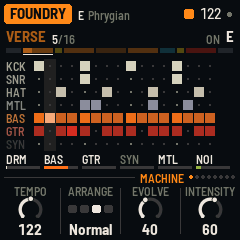

- **Tempo:** 60 to 180 (also HOME + SELECT, from any page).
- **Arrange:** Loop, Long, Normal or Short (see [The songs](#s6)).
- **Evolve:** how much changes as it plays. At 0 the riffs and patterns repeat exactly and every song is
  the same song; turned up, things change every few bars, fills come more often, and each song has new
  material.
- **Intensity:** how many layers play each section, from sparse to everything.

### SEQ: Drums

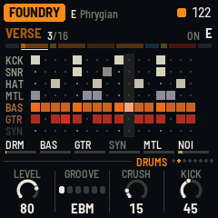

- **Level.**
- **Groove:** EBM, Rock, Break, Half (time), Thrash, Stomp. The bass and the riffs are written for the
  groove: changing it writes them again from the next bar.
- **Crush:** from clean to 6 bits at a few kHz.
- **Kick:** its drive and length, from a tight knock to a distorted boom.

### LFO: Bass

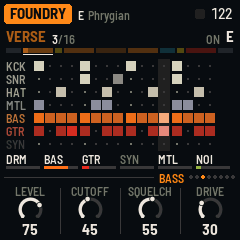

- **Level.**
- **Cutoff:** the low-pass, 55 Hz to 2.5 kHz (before the envelope).
- **Squelch:** how far the envelope opens the filter, how long it takes to close, and the resonance.
- **Drive.**

### ENV: Guitar

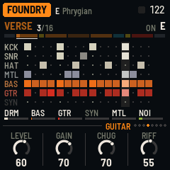

- **Level.**
- **Gain:** how hard the amp is driven, from crunch to a wall.
- **Chug:** the palm mute, from open and ringing to a tight chug.
- **Riff:** how busy the riffs are, from a chug a beat to sixteenths. A change writes them again from the
  next bar.

### ARP: Synth

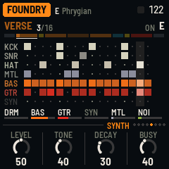

- **Level.**
- **Tone:** a saw (0), gritty FM (around 50), a metallic clang (100).
- **Decay:** short stabs to long chords.
- **Busy:** how many stabs, and how often a chorus gets a line. A change writes them again from the next
  bar.

### SEL: Metal

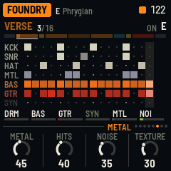

- **Metal:** the clangs' level.
- **Hits:** how many, on both patterns.
- **Noise:** the bed's level (the drone or the static, and the risers).
- **Texture:** from the drone (0) to static (100).

### FX: Space

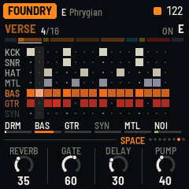

- **Reverb:** how much goes to the plate.
- **Gate:** how hard the snare's gate shuts the reverb (0: it rings free). A section without a snare
  leaves the gate open.
- **Delay:** how much goes to the ping-pong delay, a dotted eighth.
- **Pump:** how much each kick ducks everything else.

### GLO: Setup

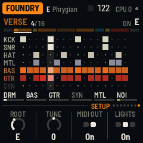

- **Root:** the root, as the keys set it.
- **Tune:** fine tuning, ±50 cents.
- **MIDI out:** on or off.
- **Lights:** On: the keys light the root, and the unlit buttons glow dimly so they can be read on the
  black FM-1. Keys: the key lights only. Off.

The top right of this page shows how much of the FM-1's time the sound takes (CPU).

---

## 9. MIDI

MIDI comes in over USB and the TRS jack, and goes out over USB.

- **In, channel 1:** a note moves the root, like a key.
- **In, clock:** the grid follows MIDI clock, and start / stop start and stop the machine (start: from the
  top of the song). The screen shows EXT for the tempo.
- **Out** (on by default): the synth on channel 1, the bass on 2, the guitars on 3 (the chord's root),
  the drums and the metal on 10 (General MIDI: kick 36, snare 38, clap 39, closed hat 42, open hat 46,
  crash 49, toms 48, 45 and 43, the anvil 56, scrap 54); and clock with start / stop when IND-1 runs on
  its own tempo. Turning MIDI out off sends all notes off.

---

## 10. Saving

IND-1 keeps all eight pieces in the FM-1's memory, each as you left it: every value, the root and the
mode, plus Tune, MIDI out and Lights.

- **By itself:** a few seconds after a change, but only while stopped. Writing to the memory interrupts
  the sound for a moment, so it never happens while the machine runs. A dot at the top of the screen
  means there are unsaved changes.
- **SAVE:** saves now, running or not.
- **Hold SAVE** for 1.5 s: the piece goes back to its recipe. That isn't saved until the next save, so
  switching off before then brings your version back.

Mutes aren't saved: they're for playing.

---

## 11. Troubleshooting

**Update mode:** hold OCT− and OCT+ together for five seconds. A countdown appears; let go before it
ends to cancel (no fill and no mutate happen).

**Calibration:** if a button or knob does the wrong thing, hold OCT− and OCT+ while you switch the FM-1
on. The screen then asks you to press each button and turn each knob in turn.

**Clicks or dropouts:** the Setup page shows how much of the FM-1's time the sound takes. The busiest
settings (every layer in, long synth chords, Busy and Hits up, at a fast tempo) cost the most; turning a
layer you don't need to 0 saves its share.

**After a crash:** IND-1 shows a red CRASH screen and restarts by itself a few seconds later. The next
start shows RESTARTED AFTER A CRASH and an address (PC ...) for a moment. If you report the problem,
include that address and what you were doing.

**Safe mode:** if IND-1 crashes twice in a row while starting, it starts in SAFE MODE instead. There's
no sound, but USB works, so the web installer can reach it: reinstall IND-1, or put the stock firmware
back from the same page. Press PLAY to try starting IND-1 normally again. If even safe mode fails twice,
the FM-1 drops into the chip's own update mode, and only the rescue below can reach it.

### Recovering an FM-1 that won't start

An FM-1 in the chip's own update mode shows a blank screen, and neither the web installer nor M-VAVE's
updater can see it. A script in the IND-1 source puts M-VAVE's firmware back, on a Mac, with the USB
cable you already have. In Terminal, from the IND-1 folder:

```
bash tools/fm1_rescue.sh
```

1. If a window asks to install the command line developer tools, click Install. When it has finished,
   run the line again.
2. If it asks for a password, type your Mac password (nothing shows as you type) and press Return.
3. When it says it's waiting, plug the FM-1 in and switch it on. The script catches it, checks the
   chip, saves a backup of the FM-1's memory in the `fm1-rescue` folder in your home folder, and asks
   before it writes anything.
4. Type **yes** and press Return. Don't unplug anything until it says it's restarting the FM-1. The
   FM-1 then starts into its original firmware, and you can install IND-1 again from there.

The script downloads M-VAVE's FM-1 V15 firmware and JieLi's flash loader, and checks both against known
fingerprints. It writes only the firmware area of the memory, never the bootloader or the FM-1's own
settings, and checks everything it writes. Running it again is always safe. If the FM-1 never shows up
at all, Felucca's [FM-1-transporter](https://github.com/kurogedelic/FM-1-transporter) (a small RP2040
board wired to the USB lines) can still reach it.

---

## 12. Parameters

The defaults are Foundry's; each piece has its own.

| Page | Value | Range | Foundry |
|---|---|---|---|
| Machine | Tempo | 60–180 | 122 |
| Machine | Arrange | Loop, Long, Normal, Short | Normal |
| Machine | Evolve | 0–100 | 40 |
| Machine | Intensity | 0–100 | 60 |
| Drums | Level | 0–100 | 80 |
| Drums | Groove | EBM, Rock, Break, Half, Thrash, Stomp | EBM |
| Drums | Crush | 0–100 | 15 |
| Drums | Kick | 0–100 | 45 |
| Bass | Level | 0–100 | 75 |
| Bass | Cutoff | 0–100 (55 Hz – 2.5 kHz) | 45 |
| Bass | Squelch | 0–100 | 55 |
| Bass | Drive | 0–100 | 30 |
| Guitar | Level | 0–100 | 60 |
| Guitar | Gain | 0–100 | 70 |
| Guitar | Chug | 0–100 | 70 |
| Guitar | Riff | 0–100 | 55 |
| Synth | Level | 0–100 | 50 |
| Synth | Tone | 0–100 | 40 |
| Synth | Decay | 0–100 | 30 |
| Synth | Busy | 0–100 | 40 |
| Metal | Metal | 0–100 | 45 |
| Metal | Hits | 0–100 | 40 |
| Metal | Noise | 0–100 | 35 |
| Metal | Texture | 0–100 | 30 |
| Space | Reverb | 0–100 | 35 |
| Space | Gate | 0–100 | 60 |
| Space | Delay | 0–100 | 30 |
| Space | Pump | 0–100 | 40 |
| Setup | Root | C – B | E |
| Setup | Tune | −50 – +50 cents | 0 |
| Setup | MIDI out | Off, On | On |
| Setup | Lights | Off, On, Keys | On |
| ALGORITHM | Mode | 8 modes | Phrygian |

---

## 13. Credits

IND-1 is free software under the GNU General Public License, version 3. If you share the firmware, you
must also share its source code.

- The sound is after the records of KMFDM, Nine Inch Nails and Ministry, and the instruments on them:
  the Oberheim Xpander, the Sequential Prophet VS and Pro-1, the Minimoog, the E-mu Emulator and EMAX,
  the Fairlight, the Akai samplers, the Roland TR-909.
- IND-1 is built on [AMB-1](https://github.com/charlesvestal/fm1-amb) by Charles Vestal: its engine's
  frame, the screen and knob code, the simulator and the browser emulator.
- The reverb is Jon Dattorro's plate ("Effect Design, Part 1", JAES 1997), by way of FoMni-1 and AMB-1.
- The Euclidean rhythms are Godfried Toussaint's reading of Bjorklund's algorithm.
- The platform (hardware layer, USB, update loader, installer and storage) is from **Felucca** by Leo
  Kuroshita, Hügelton Instruments, by way of [X0X](https://github.com/charlesvestal/fm1-x0x) and AMB-1.
- The idea of running FM-1 firmware in the browser comes from [Groove OS](https://www.groove-os.com/).
- The fonts are Barlow Semi Condensed and Terminus (SIL Open Font License).

M-VAVE and FM-1 are trademarks of their owners. IND-1 is not connected with M-VAVE, KMFDM, Nine Inch
Nails, Ministry or Hügelton Instruments.
